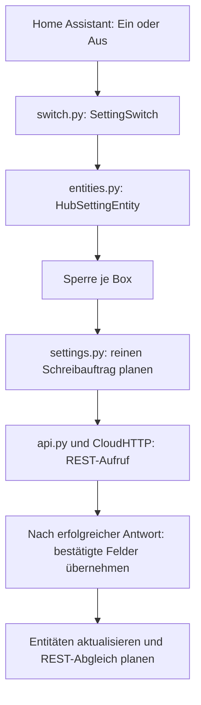

# Prüfung der Schalter-Implementierung

Der [HACS-Review](https://github.com/hacs/default/pull/13798#pullrequestreview-5928093514)
beanstandete insbesondere `UbpetAutoCleanSwitch`, `UbpetDeodorantAlertSwitch`,
`_set_auto_clean` und `_set_deodorant_alert` aus der damals veröffentlichten
Implementierung. Diese Klassen und Hilfsmethoden sind im neuen Quellstand
entfernt. Es wird kein alter Schaltercode importiert oder als Rückfall geladen.

## Aufbau

`switch.py` setzt ausschließlich die HA-Schnittstelle um: Zustandsabfrage sowie
Ein- und Ausschalten. Die Methodennamen dieser Schnittstelle sind durch Home
Assistant vorgegeben. Die gerätespezifischen Regeln liegen als eigene
Einstellungsdefinitionen im gemeinsamen Modell. So verwenden Schalter,
Uhrzeiten, Zahlen und Tagesauswahl denselben Schreibpfad.

Für eine Änderung liest das Modell die zum Gerät gehörenden Felder, prüft die
vorhandenen Daten und erzeugt einen `SettingWrite`. Der Netzwerkaufruf erfolgt
außerhalb des HA-Eventloops. Änderungen derselben Box laufen nacheinander;
andere Boxen werden dadurch nicht gesperrt. Erst nach einer erfolgreichen
REST-Antwort werden die übermittelten Felder lokal übernommen. Ein Geräte-
oder App-Test muss zusätzlich bestätigen, dass die Einstellung tatsächlich
angewendet wurde.

## Vergleich mit dem bisherigen Verhalten

Der synthetische Referenzbestand
[2026.11.10.1-switch-contract.json](../.github/fixtures/2026.11.10.1-switch-contract.json)
enthält **16 Schalter mit jeweils Ein und Aus**, also 32 Befehle. Er hält die
bisherigen HTTP-Methoden, Pfade und JSON-Nutzdaten fest. Es sind keine
Kontodaten oder Mitschnitte echter Geräte enthalten.

Die Tests prüfen diese Ergebnisse durch die neue HA-Schalterklasse und den
neuen REST-Client hindurch. Erfasst sind automatische Reinigung, Geruchsblock,
Kindersicherung, Fremdkörpererkennung, Schüttelmodus, Behälterwarnung,
Leerungserinnerung samt sieben Wochentagen, Nicht-stören- und Lichtzeitplan.
Nach einer erfolgreichen Antwort wird außerdem der neue Schaltzustand geprüft.

Zusätzliche Tests prüfen fehlende Besitzerrechte und eine unterbrochene
Verbindung. Beide Fehler lassen den bisherigen Snapshot unverändert. Die
bestehenden Tests sichern gleichzeitige Zeitplanänderungen und den Erhalt
unveränderter Uhrzeiten, Wochentage und Reinigungsverzögerungen ab.

## Was daraus folgt

Die neue Struktur ist eine gemeinsame Umsetzung der benötigten Funktionen.
Es wurden keine alten Schalterklassen lediglich umbenannt. Der Referenztest
belegt die erfassten Befehle; er ist weder eine rechtliche Freigabe noch ein
Ersatz für den noch offenen C20-Test. Die [Herkunftsprüfung](LIZENZPRUEFUNG.md)
bezieht deshalb auch das gemeinsame Modell, die Entity-Basis und den Client ein.
